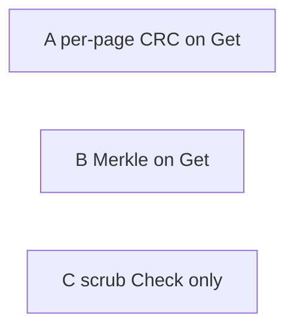

# On-disk bit-rot detection

Today only the `Meta` struct (pages 0 and 1) has a checksum (FNV-1a). Branch, leaf, overflow, and freelist pages are unhashed. `Get` returns mmap bytes with no integrity check. A flipped bit in a value is returned as good data.

This note compares three ways to detect that corruption, then records the approach we will implement.

API for all three: keep `Get(key []byte) []byte`. Add `GetWithError(key []byte) ([]byte, error)` so a missing key is `nil, nil` and bit rot is `nil, ErrPageChecksum`.

**Decision: Approach A** (per-page self-CRC, verify on every read). B and C remain alternatives. Staged implementation is in [PLAN.md](PLAN.md).

---

## Approach A — Per-page self-checksum, verify on every read

Each page (and overflow span) stores CRC-64 of its own bytes. `Tx.page` recomputes the CRC on every load used by `Get` / `Cursor`. `Tx.Check` verifies every reachable page.

The parent does **not** store the child’s CRC. Meta’s FNV checksum still covers only the commit pointer (root pgid, freelist pgid, high-water mark, txid).

**Catches:** flipped bits in a page you actually read (header, keys, values, child pgids). A rotten pgid inside a branch fails when that **branch** page’s CRC is checked.

**Misses:** a **wrong but self-valid** page at that pgid (lost write, block reuse, or a copy of another valid leaf into this slot). The parent still points at pgid N; page N hashes correctly as *some* page.

**Tradeoffs**

- Simplest format: only `Page.checksum` (header 16→24 bytes). Branch elements unchanged; fanout unchanged.
- Copy-on-write already writes new pages; CRC after `node.write`.
- Get cost: hash ~4KiB × tree height (cache per Tx so `seek` does not rehash the root every time).
- Weakest of the three for “this child is the one the parent meant.”

---

## Approach B — Merkle page tree, verify on every read

Approach A, plus:

- Each `branchPageElement` stores the child’s page CRC.
- Meta stores `rootChecksum` and `freelistChecksum` (covered by existing meta FNV).
- On Get: verify self-CRC, then **child CRC == parent slot**. Root CRC must equal meta.

Writes already copy-on-write the path to root; spilling a leaf updates parent inodes, so Merkle updates piggyback on spill.

**Catches:** everything A catches, plus a **swapped/stale page** at a live pgid (valid CRC, wrong content vs parent).

**Misses:** crafted pages (CRC is not a MAC). Bit rot on a page never read, until `Check()` or that key is fetched.

**Tradeoffs**

- Strongest online detection.
- Larger format break: branch element 16→24 bytes, slightly fewer keys per branch, slightly taller trees.
- More code in inode serialize, `node.spill`, and meta.
- Same Get CPU as A plus a uint64 compare (negligible vs hashing).
- v2 files cannot gain this without compact/rewrite.

---

## Approach C — Per-page CRC, verify only on scrub (`Check`)

Same on-disk CRC as A (optionally Merkle fields as in B, but **not** checked in `Tx.page`).

`Get` stays as fast as today. Detection is explicit: `Tx.Check`, `bbolt check`, optional `StrictMode` after commit, or a periodic scrub.

**Catches:** all reachable pages when Check runs (A-level, or B-level if Merkle fields exist).

**Misses:** silent rotten `Get` **between scrubs**. Production bbolt rarely runs `Check` on the latency path.

**Tradeoffs**

- No Get/Cursor regression; best when p99 read latency must not change.
- Detection lag unless scrub is scheduled.
- Smaller implementation if Merkle is skipped (Check already walks the tree).
- Does not detect bit rot on each Get.
- Can ship C first and later enable verify-on-read (A or B) behind an option.

---

## Comparison

| | A Self-CRC on Get | B Merkle on Get | C Scrub / Check only |
|--|--|--|--|
| Detect rot on `Get` | Yes (pages touched) | Yes (pages touched + parent binding) | No |
| Swapped valid page | No | Yes | Only if Merkle stored and Check compares it |
| Full-tree coverage | Only via `Check`, or keys you read | Same | Yes, when Check runs |
| Get latency | CRC × height | CRC × height | Unchanged |
| Format churn | Page header only | Header + branch + meta extra fields | Same as A or B |
| CoW/spill complexity | Low | Medium | Low if A-layout |
| Fits “on each Get” | Yes | Yes | No |

---

## Performance

Assumptions: 4KiB pages (typical `os.Getpagesize()`), CRC-64 over the page, B+tree height **h ≈ 2–5**. Hashing 4KiB in Go is on the order of **~0.5–2 µs** (software CRC-64). `fdatasync` and mmap faults dominate writes and cold reads.

### Read path (`Get` / `Cursor`)

| | A Self-CRC on Get | B Merkle on Get | C Check only |
|--|--|--|--|
| Extra work per `Get` | CRC × **h** pages on the path | Same CRCs + **h** uint64 compares | **None** |
| Extra work per `Cursor.Next` | CRC **one** leaf when crossing pages (path already cached) | Same | None |
| Extra I/O | None vs today (those pages are already faulted) | None | None on Get |
| Fanout / height | Unchanged (header +8 bytes) | Branch element 16→24 B: **~20–30% fewer keys per branch** if keys are small → slightly larger **h** | Unchanged if C uses A’s layout |
| Worst case | Large **overflow** value: CRC the whole span on that Get | Same | Get unchanged; overflow hashed only at Check |

**Tx page cache** (A and B): `seek` / `Get` always starts at the root. Without a cache, a large scan that `Seek`s per key would CRC the same branches millions of times. With a per-Tx “already verified” set, each page is hashed **once per Tx**. That cache is required for A/B on cursor-heavy workloads.

**Latency ballpark (warm, h=3, 4KiB, path not yet cached):** ~2–6 µs extra CPU per Get. Cold Get is still dominated by page faults. Regression shows up on in-memory microbenchmarks; under real I/O it is usually noise.

**B-only structural cost:** lower branch fanout → more branch pages, a bit more write amplification and cache footprint. That is space/height, not hash time. A does not pay this.

### Write path (`Put` + `Commit`)

All three CRC each **spilled** dirty page once before `writeAt` (C must still store CRCs if Check is to mean anything). Cheap next to two `fdatasync`s.

| | A | B | C |
|--|--|--|--|
| Spill | `crc(page)` after `node.write` | Same + write child CRC into parent inode (parent already CoW’d) | Same as A if pages store CRC |
| Meta | Unchanged FNV | Extra two uint64s inside existing meta FNV | Unchanged FNV |
| Commit latency | ~indistinguishable from today | ~indistinguishable | ~indistinguishable |

B does **not** rehash the whole tree on commit; CoW already rewrites the path to root.

### Full-tree `Check` / scrub

Check already touches every reachable page (I/O bound). Adding CRC is extra CPU: roughly `(DB size) / CRC throughput`. Example: 10 GiB at ~2 GiB/s software CRC-64 → ~5 s CPU, often still less than reading 10 GiB from disk.

| | A | B | C |
|--|--|--|--|
| Check extra CPU | CRC all reachable pages | CRC all + Merkle slot compares | Same as A or B (this *is* the detection path) |
| How often | Optional / StrictMode | Optional / StrictMode | **Must run** on a schedule or rot is silent |
| Production risk | Rot on unread keys until Check | Same | Rot on **all** Gets until Check |

### Memory

A/B: per-Tx map of verified pgids. Bound is pages touched in that Tx, not the whole file. C: no extra map.

### How to read the numbers

- **In-RAM `Get` microbench:** A and B lose to C and to today’s code; B slightly worse than A if height grows.
- **etcd-like (Get + synced writes):** A/B add little vs `fdatasync`; C wins only if any Get tax is unacceptable.
- **Range scan:** A/B are fine **with** a per-Tx verify cache; without it they are much worse than C.
- **Unread keys:** all three need `Check` for full-file coverage; only C *relies* on it for Gets.

---

## What we will implement (A)

- File format version 3: `checksum uint64` on the page header. Branch and meta layouts unchanged.
- CRC-64 ISO over `(overflow+1)*pageSize`, checksum field treated as zero.
- Verify on `Tx.page` for version 3; skip for version 2.
- Per-Tx cache of verified page IDs.
- `GetWithError`, `Cursor.Err()`, `Tx.Err()`; `View`/`Update` surface `tx.err`.
- `Tx.Check` / `bbolt check` CRC every reachable page.
- `compact` rewrites a v2 file as v3.

**Out of scope for this work:** Merkle parent/child checksums, verify-only-on-Check as the Get path, cryptographic MACs, in-place conversion of v2 files without compact.
